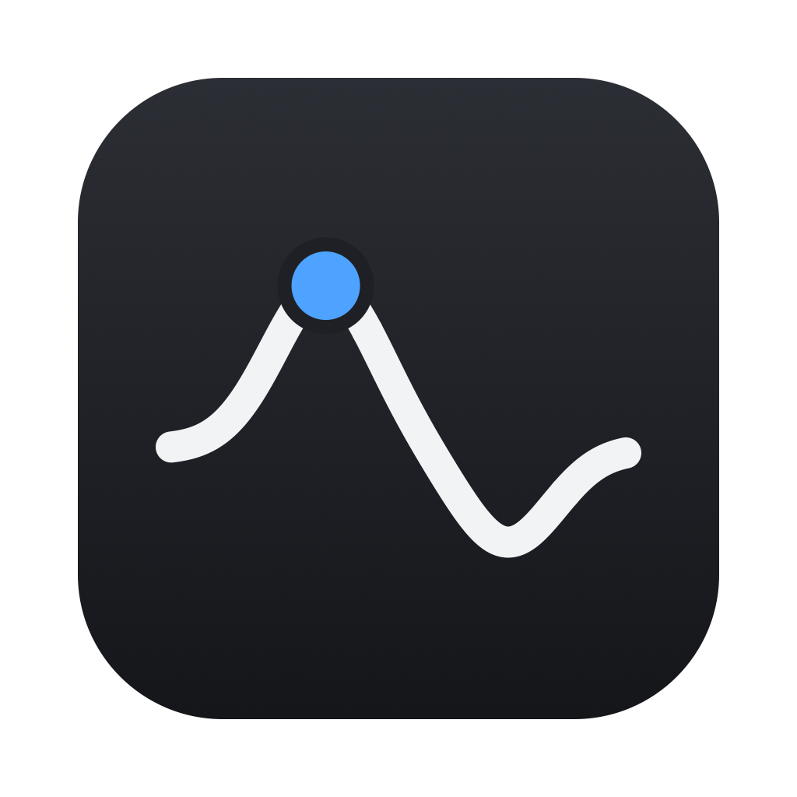
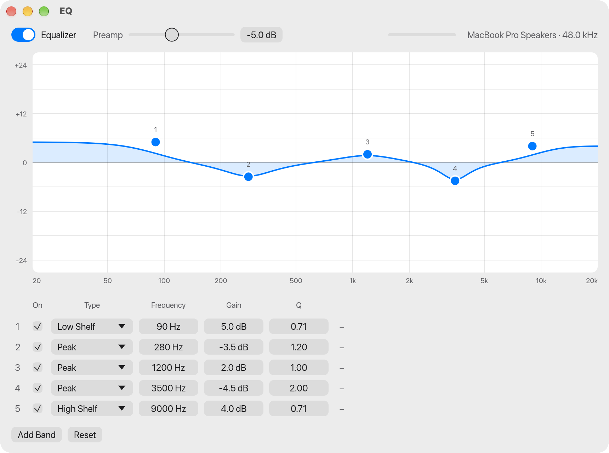

<h1 align="center">
  <br>
  EQ: system-wide parametric equalizer for macOS
</h1>

<p align="center">
  A free, open-source parametric EQ for every sound your Mac plays.<br>
  No audio driver, no kernel extension, no account.
</p>

<p align="center">
  <a href="https://github.com/dylenq/macos-parametric-eq/releases/latest"><b>Download for macOS</b></a>
  · macOS 14.2 or later · Apple silicon and Intel
</p>

<picture>
  <source media="(prefers-color-scheme: dark)" srcset="docs/screenshot-dark.png">
  
</picture>

EQ applies a parametric equalizer to all system audio on macOS: music apps, browsers,
games and calls, on speakers or headphones. Shape the sound by dragging points on a
frequency-response curve, the way you would in a studio EQ plugin, and hear the change
immediately.

Unlike most Mac equalizers it does not install a virtual audio device. It uses the
process tap API Apple added in macOS 14.2, so there is nothing to uninstall and your
output device and volume keys keep working as usual.

## Features

- **System-wide.** One EQ for everything the Mac plays, with no per-app setup.
- **Fully parametric.** Up to 16 bands, each with its own frequency (20 Hz to 20 kHz),
  gain (±24 dB) and Q.
- **Five filter types.** Peak, low shelf, high shelf, low pass and high pass.
- **Interactive curve.** Drag a band to set frequency and gain, scroll to change Q,
  double-click to add a band, right-click to change its type.
- **Preamp and clip indicator.** Lower the preamp when boosts push the output past
  full scale.
- **Bypass.** Switch the EQ off and on (⌘B) to compare with the original sound.
- **Undo and redo.** Every edit can be undone, including Reset.
- **Follows your output.** Switching between speakers and headphones keeps the EQ running.
- **Native feel.** Light and dark appearance, your system accent color, and a full menu bar.
- **Private.** Audio is processed on your Mac and never leaves it. The app makes no
  network connections.

## Install

1. Download `EQ.zip` from the
   [latest release](https://github.com/dylenq/macos-parametric-eq/releases/latest) and unzip it.
2. Move `EQ.app` to Applications and open it.
3. The app is not notarized by Apple, so macOS blocks the first launch. Open
   **System Settings > Privacy & Security**, scroll down, and click **Open Anyway**.
4. Allow system audio capture when macOS asks. If you hear nothing, enable EQ under
   **System Settings > Privacy & Security > Screen & System Audio Recording**.

Quitting the app restores normal audio immediately.

## Using it

| To do this | Do this |
| --- | --- |
| Move a band | Drag its point on the curve |
| Change Q (bandwidth) | Scroll or pinch over the point |
| Add a band | Double-click empty space on the curve, or press ⌘N |
| Change filter type, disable or delete a band | Right-click the point |
| Type exact values | Use the band list under the curve |
| Compare with the original sound | Toggle **Equalizer**, or press ⌘B |
| Undo, redo | ⌘Z, ⇧⌘Z |

## FAQ

**Do I need BlackHole, Soundflower or another virtual audio driver?**
No. EQ captures system audio with a Core Audio process tap, which is built into macOS
14.2 and later.

**Why does macOS ask for permission to record audio?**
Reading system audio is what lets the app equalize it, and macOS guards that behind the
"System Audio Recording" permission. Nothing is recorded or saved.

**Which Macs does it run on?**
Any Mac on macOS 14.2 (Sonoma) or later. The download is a universal build; it is
developed on Apple silicon and the Intel half has not been tested yet.

**Why is there a warning the first time I open it?**
The app is not signed with an Apple Developer ID, so Gatekeeper asks you to confirm.
The source is here if you would rather build it yourself.

**How do I uninstall it?**
Quit the app and delete `EQ.app`. Settings live in
`~/Library/Application Support/eq/state.json`. No drivers or background services are
installed.

## How it works

EQ creates a Core Audio process tap of all system audio except its own, muting the
original at the hardware while it is being read. A private aggregate device pairs the tap
with your real output device, and a single IOProc runs the audio through a cascade of
biquad filters (RBJ Audio EQ Cookbook designs) on its way to the speakers. Parameter
changes reach the audio thread through a lock-free queue and are smoothed to avoid clicks.

It is written in Rust, with [egui](https://github.com/emilk/egui) for the interface and
[objc2](https://github.com/madsmtm/objc2) for Core Audio.

## Build from source

You need Xcode's command line tools and Rust (via [rustup](https://rustup.rs)).

```sh
rustup target add aarch64-apple-darwin x86_64-apple-darwin
./scripts/bundle.sh
open target/EQ.app
```

Run the app from the bundle rather than with `cargo run`: macOS only grants audio
capture to an app bundle. `./scripts/bundle.sh --zip` also writes `target/EQ.zip`.

```sh
cargo test                                         # DSP and undo unit tests
target/EQ.app/Contents/MacOS/eq --headless 10      # no window, prints levels
```

## License

GPL-3.0. See [LICENSE](LICENSE).
