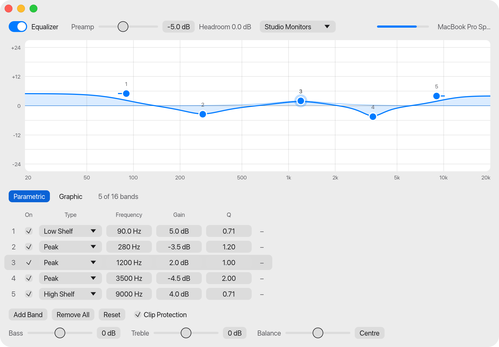
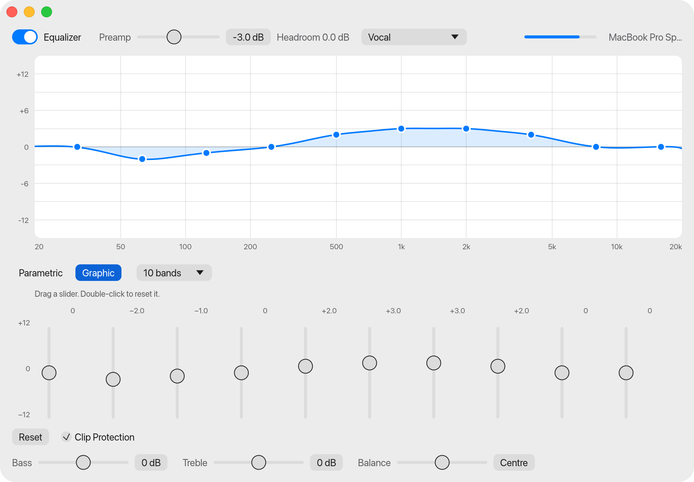

<h1 align="center">
  <br>
  EQ: system-wide parametric equalizer for macOS
</h1>

<p align="center">
  A free, open-source parametric EQ for every sound your Mac plays.<br>
  No audio driver, no kernel extension, no account.
</p>

<p align="center">
  <a href="https://github.com/dylenq/macos-parametric-eq/releases/latest"><b>Download for macOS</b></a>
  · <a href="https://dylenq.github.io/macos-parametric-eq/">Website</a>
  · macOS 14.2 or later · Apple silicon and Intel
</p>

<picture>
  <source media="(prefers-color-scheme: dark)" srcset="docs/screenshot-dark.png">
  
</picture>

EQ applies a parametric equalizer to all system audio on macOS: music apps, browsers,
games and calls, on speakers or headphones. Shape the sound by dragging points on a
frequency-response curve, the way you would in a studio EQ plugin, and hear the change
immediately.

Unlike most Mac equalizers it does not install a virtual audio device. It uses the
process tap API Apple added in macOS 14.2, so there is nothing to uninstall and your
output device and volume keys keep working as usual.

## Features

- **System-wide.** One EQ for everything the Mac plays on your output, with no per-app
  setup. Apps you send to another device play there untouched.
- **Fully parametric.** Up to 16 bands, each with its own frequency (20 Hz to 20 kHz),
  gain (±24 dB) and Q.
- **Five filter types.** Peak, low shelf, high shelf, low pass and high pass.
- **Graphic mode too.** Switch to 5, 10, 15 or 31 sliders at the standard ISO
  frequencies, ±12 dB each. The curve passes smoothly through every slider, and changing
  the number of sliders keeps its shape. Each mode keeps its own settings.
- **Interactive curve.** Drag a band to set frequency and gain, scroll to change Q,
  double-click to add a band, right-click to change its type or invert its gain. Values
  snap to round numbers as you drag, and the arrow keys nudge the selected band.
- **Bass, treble and balance.** Shelves at 100 Hz and 10 kHz (±12 dB) and a left/right
  balance that turns the other side down, in both modes.
- **Presets.** Four built-in presets (Flat, Bass, Treble and Vocal), and your own saved by
  name. A preset keeps the whole sound: mode, bands or sliders, preamp, bass, treble and
  balance. Switch from the window, the menu bar or the Presets menu, and right-click one of
  your presets to rename or delete it. Applying a preset can be undone.
- **A curve for each output.** Speakers and headphones each remember their own EQ and get
  it back when you switch to them. Turn this off under Equalizer to use one curve everywhere.
- **AutoEq import.** Load a headphone correction from [AutoEq](https://autoeq.app), or any
  Equalizer APO `ParametricEQ.txt` file, as a preset. Importing never replaces a preset you
  already have: a name in use gets a number.
- **Stays in the menu bar.** Close the window and the EQ keeps running. Switch presets or
  bypass it from the menu bar item, and optionally open it at login.
- **Clip protection.** A limiter turns the output down for a moment when boosts would
  push it past full scale, so it never distorts. On by default, with a checkbox under the
  band list.
- **Headroom and a suggested preamp.** The top bar shows how far the loudest boost stays
  under full scale, or how far over it goes, and offers the preamp that just fits. With
  clip protection off, the part of the curve that would clip is drawn in red.
- **Bypass.** Switch the EQ off and on (⌘B) to compare with the original sound.
- **Undo and redo.** Every edit can be undone, including Reset, Remove All and applying a
  preset, and messages about them offer Undo right there.
- **Follows your output.** Switching between speakers and headphones keeps the EQ running,
  on the speaker pair your interface is set to use in Audio MIDI Setup.
- **Native feel.** Light and dark appearance, your system accent color, and a full menu bar.
- **Private.** Audio is processed on your Mac and never leaves it. The app makes no
  network connections.

<picture>
  <source media="(prefers-color-scheme: dark)" srcset="docs/screenshot-graphic-dark.png">
  
</picture>

## Install

1. Download `EQ.zip` from the
   [latest release](https://github.com/dylenq/macos-parametric-eq/releases/latest) and unzip it.
   Each release comes with `EQ.zip.sha256`; `shasum -a 256 EQ.zip` should print the same checksum.
2. Move `EQ.app` to Applications and open it.
3. The app is not notarized by Apple, so macOS blocks the first launch. Open
   **System Settings > Privacy & Security**, scroll down, and click **Open Anyway**.
4. Allow system audio capture when macOS asks. If you hear nothing, enable EQ under
   **System Settings > Privacy & Security > Screen & System Audio Recording**.

Closing the window leaves EQ running in the menu bar. Quitting the app (⌘Q) restores
normal audio immediately.

## Using it

| To do this | Do this |
| --- | --- |
| Move a band | Drag its point on the curve |
| Change Q (bandwidth) | Scroll or pinch over the point |
| Add a band | Double-click empty space on the curve, or press ⌘N |
| Change filter type, disable or delete a band | Right-click the point |
| Type exact values | Use the band list under the curve; "1.5k", "-3 dB" and "0,7" work too |
| Nudge the selected band | ←/→ moves it a twelfth of an octave, ↑/↓ half a dB, ⌥↑/⌥↓ changes Q |
| Switch between parametric and graphic | ⌘1, ⌘2, or the buttons above the bands |
| Reset a slider, bass, treble, balance or the preamp | Double-click it |
| Compare with the original sound | Toggle **Equalizer**, or press ⌘B |
| Undo, redo | ⌘Z, ⇧⌘Z |
| Save the curve as a preset | Choose **Save As…** from the preset menu, or press ⇧⌘S |
| Update the current preset | ⌘S |
| Import an AutoEq file | **Presets > Import…**, or drop the `.txt` file on the window |
| Keep EQ running out of sight | Close the window; reopen it from the menu bar item or the Dock |
| Start EQ when you log in | **EQ > Open at Login** |

## Troubleshooting

**The status says "Waiting for audio…".** EQ starts processing when something plays. If
something is playing and it still waits, EQ has not been allowed to capture audio: enable
it under **System Settings > Privacy & Security > Screen & System Audio Recording**.

**The status says EQ can't process the output's format.** The output is passing encoded
audio (such as Dolby Digital) through to a receiver. Switch passthrough off, or pick a
PCM format for the device in Audio MIDI Setup.

**"Could not start audio processing".** The message says why, for instance when another
app has exclusive use of the output. EQ tries again on its own, less often each time, and
at once when you switch outputs.

**EQ started with default settings.** Settings saved by a newer version of EQ, or a
damaged settings file, are moved aside to `state.unreadable.json` in
`~/Library/Application Support/eq/` instead of being overwritten, and EQ says so.

**Something else.** Run this in Terminal and include the output in a bug report. It only
reads: it starts no audio and changes nothing.

```sh
/Applications/EQ.app/Contents/MacOS/eq --status
```

## FAQ

**Do I need BlackHole, Soundflower or another virtual audio driver?**
No. EQ captures system audio with a Core Audio process tap, which is built into macOS
14.2 and later.

**Why does macOS ask for permission to record audio?**
Reading system audio is what lets the app equalize it, and macOS guards that behind the
"System Audio Recording" permission. Nothing is recorded or saved.

**Which Macs does it run on?**
Any Mac on macOS 14.2 (Sonoma) or later. The download is a universal build; it is
developed on Apple silicon and the Intel half has not been tested yet.

**Why is there a warning the first time I open it?**
The app is not signed with an Apple Developer ID, so Gatekeeper asks you to confirm.
The source is here if you would rather build it yourself.

**How do I use an AutoEq headphone profile?**
Find your headphones on [autoeq.app](https://autoeq.app), choose "EqualizerAPO
ParametricEq" as the equalizer app, and download the file. Import it with
**Presets > Import…**. Up to 16 filters are used; peak, shelf and pass filters are
supported, with Q or a bandwidth in octaves.

**Does EQ change apps I send to another output?**
No. EQ equalizes what plays on your current output. An app you route to another device,
such as a call on a headset while music plays on the speakers, plays there untouched.

**How do I uninstall it?**
Turn off **EQ > Open at Login** if you enabled it, quit the app and delete `EQ.app`.
Settings live in `~/Library/Application Support/eq/`. No drivers or background services
are installed.

## How it works

EQ creates a Core Audio process tap of what plays on your output device, except its own
sound, mixed to stereo, and mutes the original on that device while it is being read.
Audio that apps send to other devices is not tapped. A private aggregate device pairs the
tap with your real output device, and a single IOProc runs the audio through a cascade of
biquad filters (RBJ Audio EQ Cookbook designs) on its way to the speakers. The IOProc asks
for the tap's input only, so that a headset's microphone is not started. In graphic mode
the sliders describe a smooth curve, and the gains of one peak filter per slider (plus a
shelf beyond each end) are solved for together so that the filters follow it. Parameter
changes reach the audio thread through a lock-free queue and are smoothed to avoid clicks.

The audio thread does not allocate, lock or panic into Core Audio. It turns a stray NaN
from any app into silence instead of letting it stick in the filters, keeps the filter
state out of the subnormal numbers that slow Intel processors down, and leaves alone an
output whose format is not 32-bit float.

It is written in Rust, with [egui](https://github.com/emilk/egui) for the interface and
[objc2](https://github.com/madsmtm/objc2) for Core Audio.

## Development

### Requirements

- macOS 14.2 or later.
- Xcode, or its command line tools. With only the command line tools the app gets the
  flat icon; Xcode's `actool` builds the layered one macOS 26 shows.
- Rust 1.95 or later, through [rustup](https://rustup.rs), with both Mac targets:

  ```sh
  rustup target add aarch64-apple-darwin x86_64-apple-darwin
  ```

### Build and run

```sh
./scripts/bundle.sh          # universal build, wrapped and signed in target/EQ.app
open target/EQ.app
```

Run the app from the bundle rather than with `cargo run`: macOS only grants audio
capture to an app bundle. `./scripts/bundle.sh --zip` also writes `target/EQ.zip` and
`target/EQ.zip.sha256`.

```sh
cargo test                                          # DSP, presets, import, undo, layout
cargo clippy --all-targets -- -D warnings
target/EQ.app/Contents/MacOS/eq --status            # output device, format, settings
target/EQ.app/Contents/MacOS/eq --headless 10       # equalize without a window, print levels
cargo test --release screenshots -- --ignored       # redraw the screenshots in docs/
```

Only one EQ runs at a time, since two would capture each other's output; quit the app
before trying `--headless`.

### Dependencies

| Crate | Used for |
| --- | --- |
| `eframe`, `egui` | The window and everything drawn in it, rendered with wgpu on Metal |
| `objc2-core-audio`, `objc2-core-audio-types` | The process tap, the aggregate device and the IOProc |
| `objc2`, `objc2-foundation`, `objc2-core-foundation`, `objc2-app-kit` | Calling Apple's frameworks: accent color, app activation |
| `objc2-service-management` | Open at Login |
| `muda`, `tray-icon` | The menu bar and the menu bar item |
| `rfd` | The Import file panel |
| `rtrb` | The lock-free queue that hands parameters to the audio thread |
| `serde`, `serde_json`, `dirs` | Saving settings to `~/Library/Application Support/eq/state.json` |
| `egui_kittest`, `image` (tests only) | Drawing the window offscreen for the screenshots |

### Configuration

The app reads no environment variables and needs no keys or accounts. Release signing is
configured for `scripts/bundle.sh` with environment variables, or a `.env` file next to
`Cargo.toml`, which git ignores. Start from [.env.example](.env.example).

| Variable | Default | Meaning |
| --- | --- | --- |
| `EQ_SIGN_IDENTITY` | `-` (ad hoc) | The codesign identity, such as `Developer ID Application: Your Name (TEAMID1234)` |
| `EQ_NOTARY_PROFILE` | none | A `notarytool` keychain profile; with `--zip`, the zip is notarized and the ticket stapled |
| `EQ_NOTARY_KEYCHAIN` | login keychain | The keychain holding that profile |
| `EQ_HARDENED_RUNTIME` | `1` | `0` signs without the hardened runtime, which notarization requires |
| `MACOSX_DEPLOYMENT_TARGET` | `14.2` | The oldest macOS to build for |

Builds are signed with the hardened runtime, which keeps other code from being loaded into
an app that can record system audio, and with the one entitlement it needs for that
(`bundle/EQ.entitlements`).

### Layout

```
src/main.rs           command line, single-instance lock, window setup
src/app.rs            the app: engine lifecycle, menus, saving, undo, messages
src/state.rs          settings, presets and per-device curves, loading and saving
src/history.rs        undo and redo
src/import.rs         the Equalizer APO / AutoEq reader
src/audio/            the tap, the aggregate device, device queries and the IOProc
src/dsp/              biquads, the smoothed filter chain and limiter, the graphic EQ fit
src/ui/               the window: top bar, curve, band list, sliders, preset sheets, theme
src/menu.rs, tray.rs  the menu bar and the menu bar item
scripts/bundle.sh     builds, signs, notarizes and zips the app
bundle/               Info.plist, entitlements and icons
docs/                 the website, served by GitHub Pages
```

## Releasing

1. Set the version in `Cargo.toml` and in `bundle/Info.plist` (`CFBundleShortVersionString`,
   and raise `CFBundleVersion`), and on the website in `docs/index.html`.
2. Commit, then tag and push the tag: `git tag v0.6.0 && git push origin v0.6.0`.
3. The [release workflow](.github/workflows/release.yml) checks that the tag matches both
   versions, builds `EQ.zip`, and attaches it with its checksum to a draft release, to
   review and publish.

Without signing secrets the release is signed ad hoc, as before. To sign it with a
Developer ID and notarize it, so that Gatekeeper opens it without a warning, add these
repository secrets:

| Secret | Value |
| --- | --- |
| `MACOS_CERTIFICATE` | The Developer ID Application certificate exported as .p12, in base64 (`base64 -i cert.p12`) |
| `MACOS_CERTIFICATE_PASSWORD` | That .p12's password |
| `MACOS_SIGN_IDENTITY` | The identity's name, as above |
| `APPLE_ID`, `APPLE_TEAM_ID` | The Apple ID and team that notarize |
| `APPLE_APP_PASSWORD` | An app-specific password for that Apple ID |

The [CI workflow](.github/workflows/ci.yml) runs clippy, the tests and a bundle on every
pull request and push to `main`. Dependabot proposes patch updates monthly.

## License

GPL-3.0. See [LICENSE](LICENSE).
